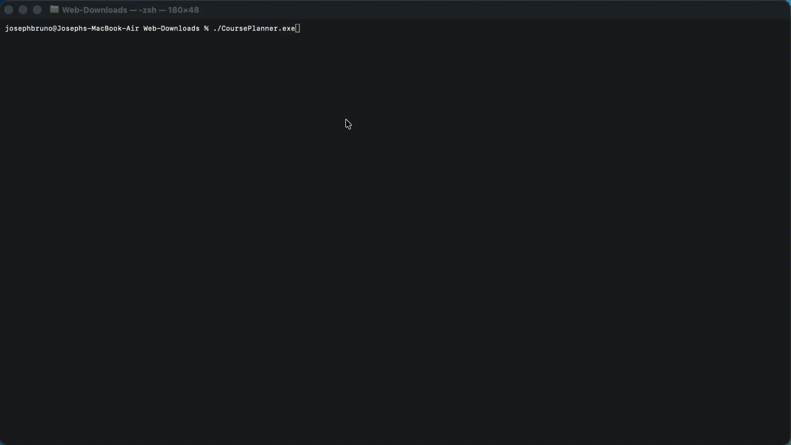
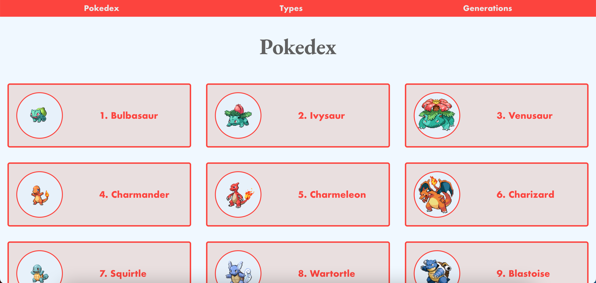

# Joseph Bruno's Portfolio

## Description

Creative Full Stack Web Developer, certified in ServiceNow System Administration, with expertise in User Interface Design and Front End Web Development. History of creating and maintaining applications for workflow optimization within a Fortune 500 consulting firm and a national educational institution. An excellent communicator and collaborator with strengths that include exceptional problem-solving, working well on team-based projects, and someone who is always willing to help and lead.

## Projects
### Course Planner
The Course Planner is an in-terminal prompt guide to search through various courses and teachers. The teachers have the courses that they teach along with the rating that they currently have. You load the courses and teachers through a CSV file and then the terminal will direct you to search for a Course or a Teacher, or list them alphabetically.

### Travlr
Travlr is a Sequelize, Express, Node.js, and Angular project for people to plan various trips showing prices, the trip duration, and where it is located.

[Travlr Public Backend](https://travlr-backend-5b39a95aa2da.herokuapp.com/index.html)
[Travlr Administrative Frontend](https://travlr-frontend-d2a22c659c77.herokuapp.com/_)

### The2Senses
Website to assist in giving Color Blindness and Hearing Disability tests to the rural communities of India. Worked with a small group to create a variety of tests to assist in identifying color blindness and hearing disabilities within the rural areas of India. It is currently being used by hundreds of Non-Governmental Organizations (NGO's) volunteers, which include the Hope Charitable Trust.

[The2Senses](https://www.the2senses.com/)

### Pokedex
A visual showcase of over 1,000 Pokemon broken down by categories such as: what generation they came from, the various types of Pokemon, and singular pages giving more info into each Pokemon.

[Pokedex](https://joey-pokedex.herokuapp.com/)

## Technologies Learned
- React.js
- Python
- C++
- Java
- Node.js
- Express
- Angular
- MongoDB
- SQL
